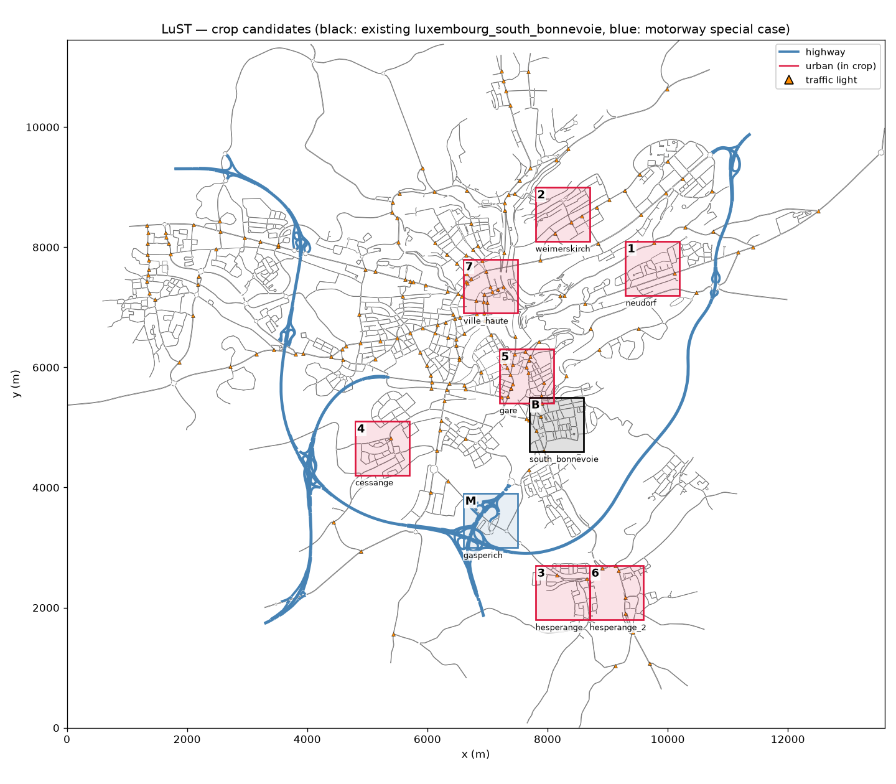
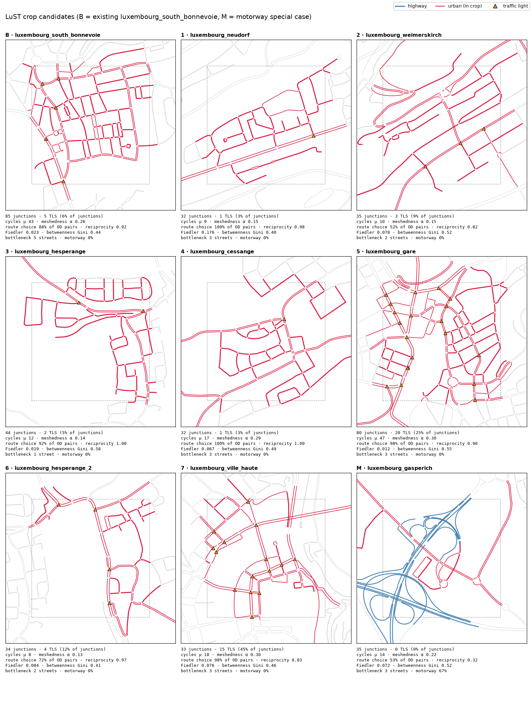
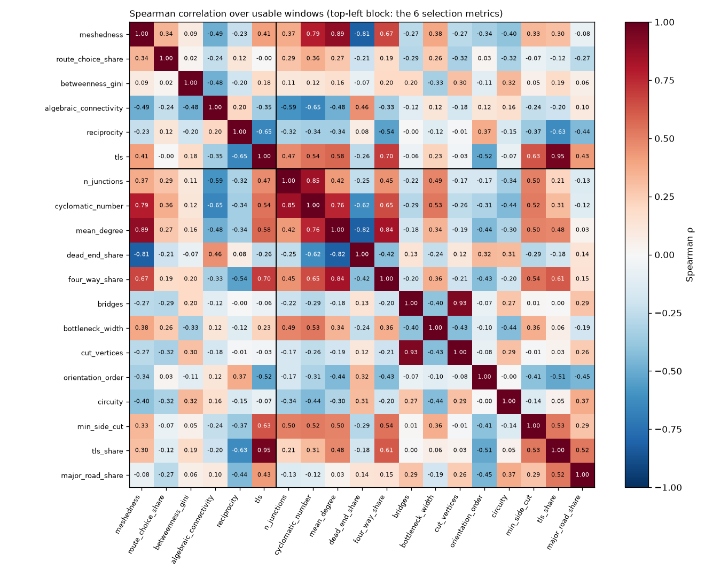
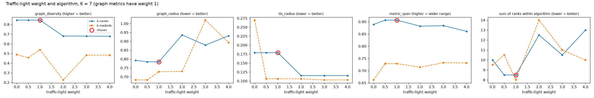
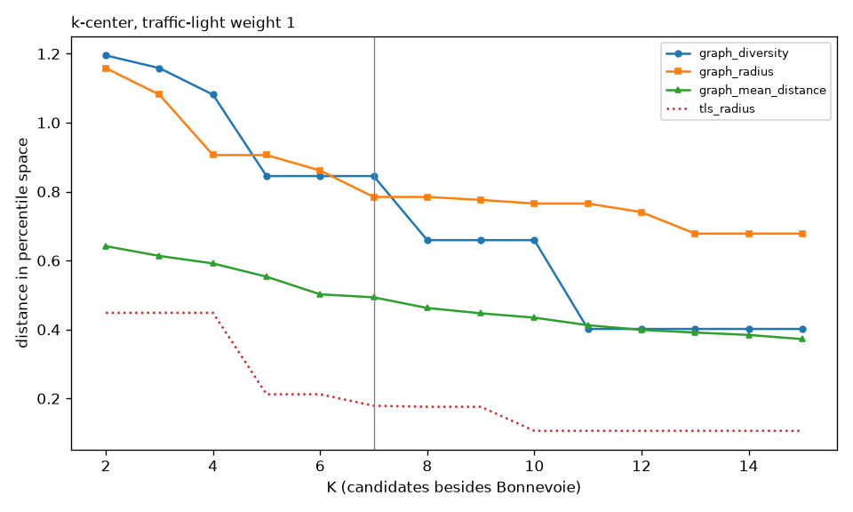
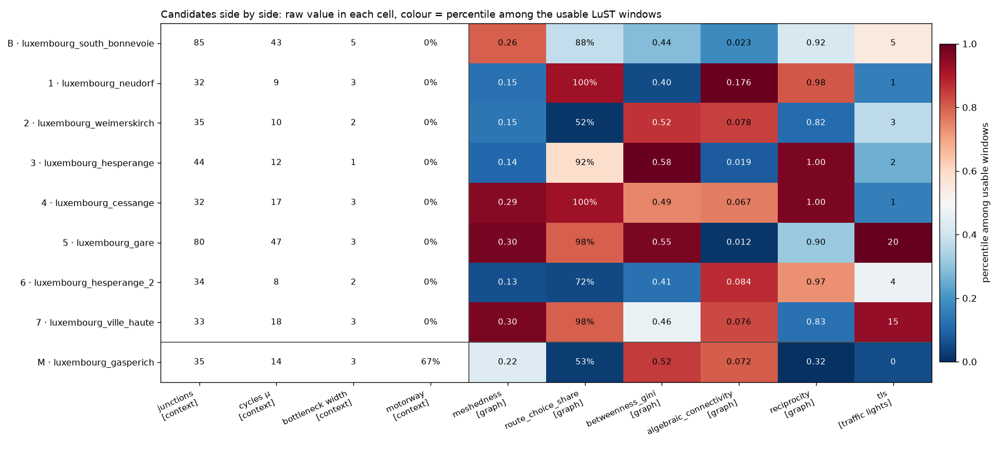
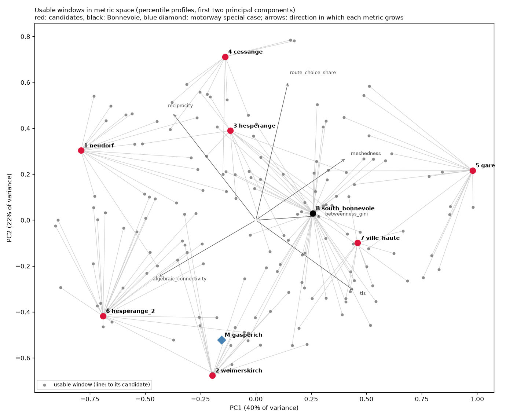

# Selecting LuST crops for URB

*Selection of 900 × 900 m parts of the LuST network that give URB different route-choice problems. Code: `tools/lux_crops/`. Date: 6 November 2026, revised the same day (see [Changes from the first version](#changes-from-the-first-version)).*

## Summary

URB has one Luxembourg network so far, `luxembourg_south_bonnevoie`, a 900 × 900 m crop of the LuST scenario. To find other parts of Luxembourg worth cropping, every 900 × 900 m window of LuST (1,549 windows on a 300 m lattice) was cut with the same rule as `build_lux_crop.py` and profiled with graph metrics (networkx) and SUMO network properties.

The windows are compared on six metrics, chosen from what the literature and URB's own design say shapes a routing game: whether OD pairs have alternative routes (route-choice share, meshedness), where routes of different agents meet (betweenness concentration, Fiedler value), one-way streets (reciprocity) and traffic lights. Grid order and circuity were dropped (Section 2). Windows with a motorway were excluded: in 14 of the 15 usable ones not a single sampled OD pair has a route choice that involves the motorway (Section 7). 165 usable street windows remain.

Each metric is converted to its percentile among the 165 windows, windows are compared by the Euclidean distance between these percentile profiles, and seven windows were chosen by farthest-point sampling (greedy k-center) starting from Bonnevoie. Result: seven candidates plus Bonnevoie whose closest pair is 0.95 apart, while a typical window lies 0.26 from its most similar neighbour; every usable window lies within 0.83 of a candidate. The candidates span 1 to 20 traffic-light junctions, meshedness 0.13 to 0.30, route choice for 52 % to 100 % of OD pairs, bottlenecks of 1 to 5 streets, and both ends of the range of every other metric.

A motorway special case (M, the Croix de Gasperich interchange) is added outside the selection: the only window where route choice involves the motorway.

| | Name | x (m) | y (m) | What sets it apart |
|---|---|---|---|---|
| B | luxembourg_south_bonnevoie | 7700–8600 | 4600–5500 | existing crop: large meshed network, middle of the range on most metrics |
| 1 | luxembourg_neudorf | 9300–10200 | 7200–8100 | few cycles but no bottleneck; route choice for every OD pair |
| 2 | luxembourg_weimerskirch | 7800–8700 | 8100–9000 | least route choice (52 % of OD pairs), many one-way streets |
| 3 | luxembourg_hesperange | 7800–8700 | 1800–2700 | residential pockets on one spine: 5 bridges, paths concentrated on few streets |
| 4 | luxembourg_cessange | 4800–5700 | 4200–5100 | small, highly meshed, all two-way, route choice for every OD pair |
| 5 | luxembourg_gare | 7200–8100 | 5400–6300 | Bonnevoie-sized and as meshed, but 20 traffic lights and a bottleneck at the rail yard |
| 6 | luxembourg_hesperange_2 | 8700–9600 | 1800–2700 | nearly a tree: few cycles, dead ends, no 4-way junctions |
| 7 | luxembourg_ville_haute | 6600–7500 | 6900–7800 | small and meshed, 15 traffic lights at 45 % of its junctions |
| M | luxembourg_gasperich | 6600–7500 | 3000–3900 | special case: motorway interchange, 67 % motorway, every route choice is between more and less motorway |





## Changes from the first version

| | First version | This version | Why |
|---|---|---|---|
| Selection metrics | 10 | 6 | grid order, circuity, bridges and motorway share dropped (Sections 2, 4, 7) |
| Motorway | metric with weight 2 | windows with a motorway excluded from the selection; Gasperich added as special case M | no motorway route choice outside the Gasperich interchange (Section 7) |
| Bottlenecks | bridges as a selection metric | bridges and bottleneck width (narrowest cut between two substantial parts) reported as context | most bridges cut off small pockets; as selection metrics both lower the diversity of the set (Section 4.3) |
| Fiedler value | on the graph with degree-2 nodes | on the junction graph (degree-2 nodes contracted) | degree-2 nodes are SUMO edge splits, not topology (Section 4) |
| Candidates | 10 | 7 | requested 6–7; 7 is the largest number before the two closest candidates move closer (Section 11) |
| Traffic lights | weight 0 to 1 gave the same set: no effect | equal weight; weight 0 would change two candidates | fewer metrics give each one more influence (Section 10) |

Kept from the first version: Bonnevoie, Neudorf, Weimerskirch, Hesperange, Cessange, Hesperange_2. Dropped: Kirchberg and Merl (motorway), and the two Gare windows with 11 and 15 traffic lights (6900–7800 × 5100–6000 and 6600–7500 × 5400–6300). New: Gare at 7200–8100 × 5400–6300 (20 traffic lights) and Ville Haute. Gasperich returns as the motorway special case, outside the selection. **The name `luxembourg_gare` now refers to a different box than in the first version.**

## 1. Goal

URB studies route choice of human drivers and automated vehicles. In a crop, agents are the trips that enter it; each agent chooses one of up to four routes for its OD pair (URB generates up to 12 paths per OD with JanuX, at least 0.4 apart in Jaccard distance, and clusters them into 4 actions; Bonnevoie averages 3.8 actions per OD), and its reward is the travel time SUMO produces. Benchmark results are travel times of humans and CAVs, the CAV advantage, the cost of training and the win rate (`analysis/readme.md`).

A crop is therefore useful when it offers route choice and when its route-choice problem differs from those of the networks already in the benchmark. The question is which other parts of LuST differ from Bonnevoie, and from each other, in the properties that shape that problem.

The method selects bounding boxes. It does not build the crops: demand, `agents.csv` and routes still come from `build_lux_crop.py`. No traffic is simulated in this pipeline.

## 2. What shapes a routing problem

| Factor | Evidence | Here |
|---|---|---|
| **Demand relative to capacity** | The strongest factor. In the URB paper, MARL performance falls with demand ("algorithmic performance decreases with the demand level"; in more congested systems one algorithm did worse than the random baseline). The price of anarchy, the gap between selfish and system-optimal routing, is substantial in real city networks (Youn et al. 2008) and varies with demand, decaying when demand is very high (O'Hare et al. 2016). | Not a property of the road graph and not measured here; check when a crop is built (Section 13). |
| **Alternative routes** | Network redundancy has two dimensions: diversity of efficient routes per OD and spare capacity (Xu et al. 2018). URB's actions are routes, so an OD pair without a distinct alternative gives the agent nothing to learn. | `route_choice_share`, `meshedness` |
| **Where routes meet** | Agents interact where their routes share links; that is what makes routing a game. Edge betweenness shows where shortest paths concentrate, but it predicts real flows poorly when demand is uneven (Kazerani & Winter 2009; Gao et al. 2013), so it is used as a structural property, not a flow forecast. A sparse cut forces many routes through few links. | `betweenness_gini`, `algebraic_connectivity` |
| **Traffic lights** | Traffic lights per km is a significant variable in drivers' route switching in GPS data (Vacca & Meloni 2015). URB's route clustering uses `traffic_lights_per_km` as a route feature (`networks/luxembourg_south_bonnevoie/clustered_routes/*/…_clustering_config.json`). | `tls` |
| **One-way streets** | One-way and two-way networks differ in capacity and in distance travelled, depending on trip length (Gayah & Daganzo 2012). One-way streets also make routes of opposite directions differ. | `reciprocity` |
| **Motorway against streets** | Share of motorway on a route is significant in route switching (Vacca & Meloni 2015). But in LuST at this window size the motorway never offers a choice (Section 7). | windows with a motorway excluded |
| **Network size** | Larger networks and fleets were harder for MARL in the URB paper. | bounded by the usable filter; reported, not used |

Two caveats apply to all structural metrics. Standard network statistics correlate poorly with the price of anarchy on synthetic road networks (Connors et al. 2019), so these metrics describe how the crops differ; they do not predict how URB algorithms will perform on them. And demand, the strongest factor, is outside the method.

**Grid order and circuity were dropped.**

- *Grid order* (Boeing's orientation order, the entropy of street bearings) describes urban form; Boeing (2019) relates it to other network indicators, not to travel outcomes. Travel times in SUMO do not depend on compass bearings: a rotated or curved grid routes the same way. What a grid does for routing, many equally good alternatives, is measured directly by route-choice share and meshedness.
- *Circuity* (median of fastest-path length / straight-line distance) varies little: 75 % of the usable windows lie between 1.10 and 1.30 (interquartile range 1.15–1.27). After the percentile transformation, 1.16 against 1.19, a 3 % difference, becomes a gap of 0.15, as large as real differences in other metrics. And it measures how direct the fastest path is, not whether there is a choice between paths. URB's route clustering does use route-level circuity, to tell the actions of one OD pair apart; that is a different quantity.

## 3. Data and network model

**Source.** `lust.net.xml` of the LuST scenario ([lcodeca/LuSTScenario](https://github.com/lcodeca/LuSTScenario)), 13.6 × 11.5 km. The LuST network has no street names, so windows are labelled with the nearest Luxembourg-City quarter; the labels are approximate.

**Graph.** `lust_graph.py` loads the network with sumolib into a networkx `MultiDiGraph`:

- nodes: SUMO junctions (2,247), with coordinates, SUMO junction type and a traffic-light flag (203 traffic-light junctions);
- arcs: SUMO edges open to passenger cars (5,779), with length, speed limit, free-flow travel time (length / speed limit), OSM road class and lane count.

A two-way street is two opposite arcs. Junction transitions are not restricted in the graph: any incoming arc may continue on any outgoing arc of the same junction. SUMO allows 10,991 of the 11,004 such transitions in LuST (99.9 %, U-turns excluded), so ignoring turn restrictions changes almost nothing.

**Cropping.** A window keeps every arc whose shape touches its bounding box and then the largest weakly connected component. This reproduces `luxembourg_south_bonnevoie`: the same 275 edges as its `.edg.xml`. The built network renames LuST edges `--X` to `X` (126 of the 275), so joins by edge ID need that mapping.

**Counting traffic lights.** `tls` counts traffic-light junctions inside the bounding box. Bonnevoie has 5 inside; its `metadata.json` reports 6 because junction `-5846` lies 10 m west of the box and is part of the crop.

**Windows.** Squares of 900 m (the size of Bonnevoie), with corners every 300 m: 1,549 windows, plus the Bonnevoie box itself. 363 windows contain at least 20 nodes and 15 junctions inside and are profiled. A window is *usable* when

| Condition | Reason | Windows removed |
|---|---|---|
| at least 30 junctions inside | enough network for route choice | 154 |
| at least 80 % of the inside nodes in the largest strongly connected component | agents can reach each other's destinations | 11 |
| a second route exists for at least half of the border OD pairs (Section 6) | URB needs route choice | 18 |
| no motorway | motorways give no route choice in these windows (Section 7) | 15 |

which leaves **165 usable windows**.

For one window, `D` is the directed simple graph of the crop (between two nodes only the fastest arc is kept), `U` its undirected graph, *inside nodes* are the nodes within the bounding box, and *junctions* are inside nodes whose degree in `U` is not 2 (degree-2 nodes only split a street into segments).

## 4. Metrics

All metrics are computed by `graph_metrics.py`. Ranges are minimum / median / maximum over the 165 usable windows.

### 4.1 Metrics used for the selection

| Metric | Definition | Computed with | Range | Reads as |
|---|---|---|---|---|
| `meshedness` | α = μ / (2n − 5), with cyclomatic number μ = \|E\| − \|V\| + c of `U` and n junctions | `nx.number_connected_components` | 0.07 / 0.22 / 0.33 | share of the cycles a planar graph of that size could have; 0 = tree |
| `route_choice_share` | share of border OD pairs with a second distinct near-shortest route (Section 6) | `nx.shortest_simple_paths` | 0.50 / 0.90 / 1.00 | whether route choice is available |
| `betweenness_gini` | Gini coefficient of edge betweenness of `D`, shortest paths by travel time | `nx.edge_betweenness_centrality` | 0.33 / 0.46 / 0.58 | high = shortest paths concentrate on a few arcs |
| `algebraic_connectivity` | Fiedler value: second-smallest eigenvalue of the normalised Laplacian of the largest component of the 2-core, with degree-2 nodes contracted | `nx.k_core`, `nx.algebraic_connectivity` | 0.010 / 0.043 / 0.423 | small = a sparse cut splits the network in two large parts |
| `reciprocity` | share of arcs whose opposite arc exists | `nx.overall_reciprocity` | 0.74 / 0.93 / 1.00 | 1 = all streets two-way |
| `tls` | traffic-light junctions inside the window (SUMO junction type `traffic_light*`) | SUMO network | 0 / 4 / 20 | traffic control |

**Fiedler value on the junction graph.** SUMO splits a street into several edges wherever an attribute changes; these degree-2 nodes make up about a third of the 2-core in a typical window (median 31 %, range 14 % to 64 %), and their number is arbitrary. They lower the Fiedler value unevenly, so it is now computed after contracting them. The ranking changes moderately (Spearman 0.88 between the two versions over the usable windows).

### 4.2 Metrics computed but not used for the selection

These are written to `out/windows_900.csv` and shown in the drawings as context (correlations over the usable windows):

| Metric | Left out because |
|---|---|
| `orientation_order` (grid order), `circuity` | no evidence that they shape routing outcomes; circuity hardly varies (Section 2) |
| `bridges`, `cut_vertices`, `bottleneck_width` | bottlenecks; reported as context, see Section 4.3 |
| `motorway_share`, `motorway_ramps`, `motorway_access`, `motorway_choice_share` | used to exclude motorway windows (Section 7) |
| `cyclomatic_number` μ | number of independent cycles; grows with size (ρ = 0.85 with the number of junctions). Shown with the number of junctions as context in the figures |
| `mean_degree`, `dead_end_share`, `four_way_share` | same axis as meshedness |
| `tls_share` | same as the traffic-light count; windows have equal area, so the count is a density |
| `min_side_cut` (Menger edge connectivity between opposite sides) | mostly reflects how many streets happen to cross the window border; 0 whenever no street crosses one side |
| `n_junctions`, `road_km` | size; bounded by the usable filter |
| `major_road_share`, `mean_lanes`, `mean_speed_limit` | road classes; related to traffic lights; kept as context |
| `scc_share` | used as a filter (Section 3) |

### 4.3 Bottlenecks

A street network with low edge connectivity has bottlenecks: closing a few streets splits it, so all traffic between the two parts must use those streets. For URB this matters in two ways. Where one street joins two parts, trips across it have no alternative and routing cannot avoid congestion there. Where two or three streets join them, agents choose among few shared links, and their choices interact strongly.

*Bridges* measure the extreme case: a bridge of the 2-core is a single street whose closure splits the meshed network. But most bridges cut off small pockets, a loop street or a short residential block. Over the 137 bridges in the usable windows, the median bridge cuts off 13 % of the window's junctions, 35 % cut off less than 10 %, and only 21 windows have a bridge that cuts off 20 % or more. The bridge count also has 56 % ties at zero.

The *bottleneck width* measures the intuition directly: the fewest streets whose closure splits the junction graph into two parts, the smaller holding at least 20 % of its junctions. It is exact for widths 1 to 3 (bridges remaining after removing up to two streets) and an upper bound above 3 (sweep over the Fiedler vector). Over the usable windows: width 1 in 18 windows, 2 in 66, 3 in 54, 4 or more in 27.

| | Selection with the six metrics | Bottleneck width instead of Fiedler | Bottleneck width as a seventh metric | Bridges instead of Fiedler |
|---|---|---|---|---|
| graph diversity (higher = better) | **0.85** | 0.68 | 0.76 | 0.81 |
| graph radius (lower = better) | **0.78** | 0.81 | 1.01 | 0.84 |
| candidates shared with the six-metric set | 7 of 7 | 2 of 7 | 0 of 7 | 4 of 7 |

Neither replaces the Fiedler value well as a selection metric. The bottleneck width takes only a few values, so most windows tie, and it grows with size (ρ = 0.49 with the number of junctions); used for selection it lowers the diversity of the set and changes most candidates. It is also nearly independent of the Fiedler value (ρ = 0.12) and of the bridge count (ρ = −0.40): the three measure different kinds of cut. (An earlier draft of this revision said the Fiedler value covers bridges; it does not: ρ = −0.12.)

The six-metric set nevertheless spans the range of bottlenecks: Hesperange has width 1 (one street cuts off 27 % of its junctions), Weimerskirch and Hesperange_2 width 2, Neudorf, Cessange, Gare and Ville Haute width 3, Bonnevoie 5. Bridges and bottleneck width are therefore reported with every candidate rather than used for the selection.

## 5. Redundancy of the selection metrics



| Metric | Largest \|ρ\| with another selection metric | R² from the other five | ρ with number of junctions |
|---|---|---|---|
| meshedness | 0.49 (algebraic_connectivity) | 0.38 | 0.37 |
| route_choice_share | 0.34 (meshedness) | 0.17 | 0.29 |
| betweenness_gini | 0.48 (algebraic_connectivity) | 0.27 | 0.11 |
| algebraic_connectivity | 0.49 (meshedness) | 0.45 | −0.59 |
| reciprocity | 0.65 (tls) | 0.45 | −0.32 |
| tls | 0.65 (reciprocity) | 0.51 | 0.47 |

At most 51 % of any metric is predictable from the others (R² of a linear model on percentiles), so each carries information of its own. The strongest pair is traffic lights and one-way streets: central windows have both.

The Fiedler value depends on size (ρ = −0.59 with the number of junctions; −0.46 before contracting degree-2 nodes). For lattice-like graphs it falls with the square of the diameter, so a window with few junctions scores as better knit. This matters for Neudorf and Cessange (32 junctions each, Section 12).

## 6. Measuring route choice

### First version and its problems

Route choice was first measured as the mean number of distinct near-shortest routes per OD pair. OD pairs join an *entry junction* (the first junction after a street enters the window) to an *exit junction* (the last before a street leaves), at least 400 m apart; up to 40 pairs are sampled per window with a fixed seed. Yen's algorithm (`nx.shortest_simple_paths`) lists the simple paths of a pair in order of travel time, at most 50, up to 1.3 × the fastest. A path counted as a distinct route if it shared at most half of its arcs (Jaccard index ≤ 0.5) with every route already counted.

Two problems showed up:

- **The 50-path cap truncated the count.** In dense grids the first 50 paths are small variations of the fastest one. The cap stopped the listing early in 17 of 26 sampled windows. Raising it to 500 raised the mean count from 7.2 to 16.2 in Bonnevoie. The ranking of windows hardly changed (Spearman 0.96 between the two caps), but the values were not counts of routes.
- **The count mostly measured size.** The number of junctions and the cyclomatic number alone explained 56 % of it (R²).

### Version used

`route_choice_share` asks a yes/no question per OD pair: is there, within 1.3 × the fastest travel time, a path that shares at most half of its arcs with the fastest path? The metric is the share of sampled OD pairs where the answer is yes. Size and cycle count explain 22 % of it (against 56 % for the count), and the 50-path cap has no effect (identical with 500 paths in the 8 densest windows). The overlap threshold is close to URB's own route generation, which keeps paths at least 0.4 apart in Jaccard distance.

`motorway_choice_share` uses the same pairs: the share whose alternative route differs from the fastest by at least 100 m of motorway, i.e. the choice is between more and less motorway.

Both count routes offered by the road graph, not routes that traffic uses (Section 13).

## 7. Motorways

The first version gave motorway share the largest weight, and its candidates included windows with 15 %, 29 % and 67 % motorway. The question here is whether a motorway gives URB agents a different kind of choice: motorway against streets.

| Window | x, y (m) | Junctions | Motorway | Route choice | Motorway choice |
|---|---|---|---|---|---|
| Merl | 5100, 5700 | 38 | 7 % | 98 % | 0 % |
| Howald-Ceinture | 7200, 3900 | 40 | 7 % | 78 % | 0 % |
| Howald-Ceinture | 7200, 3600 | 53 | 9 % | 98 % | 0 % |
| Howald | 7200, 3300 | 42 | 11 % | 90 % | 0 % |
| Kirchberg | 9900, 8700 | 48 | 13 % | 75 % | 0 % |
| Merl (first-version candidate) | 4500, 5700 | 61 | 15 % | 88 % | 0 % |
| Merl | 4800, 5700 | 50 | 17 % | 93 % | 0 % |
| Kirchberg | 9900, 9000 | 37 | 19 % | 83 % | 0 % |
| Merl | 4500, 5400 | 44 | 21 % | 85 % | 0 % |
| Strassen | 3000, 7800 | 40 | 21 % | 68 % | 0 % |
| Strassen | 3300, 7800 | 38 | 22 % | 58 % | 0 % |
| Strassen | 3000, 7200 | 49 | 22 % | 88 % | 0 % |
| Strassen | 3000, 7500 | 48 | 23 % | 80 % | 0 % |
| Kirchberg (first-version candidate) | 10200, 8700 | 32 | 29 % | 58 % | 0 % |
| Gasperich (first-version candidate) | 6600, 3000 | 35 | 67 % | 53 % | 53 % |

In 14 of the 15 usable motorway windows, no sampled OD pair has a choice between more and less motorway (also with a threshold of 300 m instead of 100 m). The motorway crosses the window as a corridor; trips on it have no alternative inside the window, and the choices that exist are among the streets beside it. An earlier exploratory SUMO run agrees: only 20 % of the agents in the Kirchberg window and 32 % in the Gasperich window had a second route, against 70 % in Bonnevoie.

**There is no useful candidate between 15 % and 67 % motorway.** The usable windows in that range have at most 29 % motorway and no motorway choice. Profiled windows with 32–65 % motorway exist (at Strassen, Merl, Kirchberg and Gasperich), but all have fewer than 30 junctions and fail the usable filter. All 8 profiled windows with any motorway choice lie at the Croix de Gasperich interchange.

Motorway windows are therefore excluded from the selection, and one is added as a **special case, M**: among the windows that pass every usable condition except the motorway one, the window whose route choice involves the motorway most often (`MOTORWAY_CASE` in `select_candidates.py`). That is the Gasperich window (6600–7500 × 3000–3900), the only one where the motorway is part of the choice: every route choice it offers differs in motorway use. Its percentiles are computed against the usable windows.

On the six selection metrics Gasperich is close to Weimerskirch (distance 0.45): both offer route choice to about half of their OD pairs and have few traffic lights. What sets it apart is the motorway (67 % of its length, 29 ramp arcs) and the one-way carriageways (reciprocity 0.32, below every usable window). Weimerskirch and Gasperich can therefore serve as a controlled pair: the same share of route choice, on streets against on a motorway.

A crop larger than 900 m around a motorway with a parallel arterial road might offer motorway-against-street choice; that was not examined.

## 8. Making metrics comparable

The metrics have different units and skewed distributions (the Fiedler value ranges from 0.010 to 0.423 with median 0.043). Raw values or z-scores would let a few extreme windows dominate the distance. Each metric is therefore replaced by its percentile among the usable windows (`pandas.rank(pct=True)`, ties get the mean rank), so every metric ranges from 0 to 1 and is spread evenly. Two windows are compared by the weighted Euclidean distance between their percentile profiles,

d(a, b) = √( Σₘ wₘ (pₘ(a) − pₘ(b))² ).

All weights are 1 (Section 10).

## 9. Selection algorithm

**Farthest-point sampling (greedy k-center).** Start with Bonnevoie. Repeatedly add the usable window whose distance to its nearest chosen window is largest. After K additions, let r be the distance of the last window added. Then no two candidates are closer than r, and every usable window is within r of some candidate. Each usable window is assigned to its nearest candidate, which shows how many windows a candidate stands for (`out/groups_900.csv`). The sets are nested: the first K candidates for K + 1 are the candidates for K.

**Alternative: k-medoids.** Each candidate is the most typical member of a group of similar windows (Voronoi iteration, initialised with farthest-point sampling, Bonnevoie fixed).

**Comparison** (K = 7, equal weights, measured in unweighted percentile space; graph space = the five graph metrics):

| Measure | Definition | k-center | k-medoids |
|---|---|---|---|
| graph diversity | distance between the two most similar candidates (higher = better) | **0.85** | 0.54 |
| graph radius | largest distance from a usable window to its nearest candidate (lower = better) | 0.78 | **0.73** |
| TLS radius | the same on the traffic-light percentile alone (lower = better) | 0.18 | **0.11** |
| mean distance to nearest candidate | (lower = better) | 0.49 | **0.40** |
| metric span | mean percentile range the set covers per metric (higher = wider) | **0.91** | 0.73 |

For scale, a usable window lies 0.22 from its most similar window in graph space (median; 90th percentile 0.32).

k-medoids represents the average window better; k-center chooses candidates that differ more and span the range of every metric. The k-medoids set covers meshedness only from p17 to p80 and the Fiedler value from p8 to p74; k-center covers both from p6 or lower to p98 or higher. The two sets share no candidate. The goal is a benchmark of different route-choice problems, so **farthest-point sampling** is used. This is a choice, stated explicitly: a sum of ranks over the first three measures with both algorithms pooled would prefer k-medoids.

## 10. Traffic-light weight

The five graph metrics have weight 1; the traffic-light weight was varied over {0, 0.5, 1, 2, 3, 4} (`out/evaluation/weights_grid.csv`). Within k-center, each measure was ranked over the six weights, and the weight with the smallest sum of ranks was chosen, ties going to equal weighting.



| Traffic-light weight | Graph diversity | Graph radius | TLS radius | Metric span | Sum of ranks | Candidates shared with the chosen set |
|---|---|---|---|---|---|---|
| 0 | 0.85 | 0.79 | 0.18 | 0.89 | 10 | 5 of 7 |
| 0.5 | 0.85 | 0.78 | 0.18 | 0.91 | 8.5 | 7 of 7 |
| **1** | **0.85** | **0.78** | **0.18** | **0.91** | **8.5** | **7 of 7** |
| 2 | 0.68 | 0.94 | 0.12 | 0.88 | 12.5 | 3 of 7 |
| 3 | 0.68 | 0.88 | 0.12 | 0.88 | 10.5 | 4 of 7 |
| 4 | 0.68 | 0.93 | 0.12 | 0.86 | 13 | 2 of 7 |

**Chosen: all weights 1.** Weights 0.5 and 1 give the same seven candidates. Unlike in the first version, traffic lights change the selection: without them (weight 0), Neudorf and Hesperange_2 are replaced by two other windows (Hesperange 8100–9000 × 2100–3000 and Kirchberg 9300–10200 × 9000–9900). The two most signalised candidates, Gare and Ville Haute, are chosen even at weight 0, because they are also structurally extreme. Weights of 2 and more cover the traffic-light range more evenly but make the two most similar candidates markedly closer (0.85 → 0.68).

## 11. Number of candidates



| K | Graph diversity | Graph radius | TLS radius | Metric span |
|---|---|---|---|---|
| 4 | 1.08 | 0.91 | 0.45 | 0.81 |
| 5 | 0.85 | 0.91 | 0.21 | 0.90 |
| 6 | 0.85 | 0.86 | 0.21 | 0.91 |
| **7** | **0.85** | **0.78** | **0.18** | **0.91** |
| 8 | 0.66 | 0.78 | 0.18 | 0.91 |
| 10 | 0.66 | 0.77 | 0.11 | 0.92 |
| 11 | 0.40 | 0.77 | 0.11 | 0.93 |

Six or seven candidates were requested. **K = 7** is the largest number before the two most similar candidates move closer (0.85 → 0.66 at K = 8), and the seventh candidate still improves coverage (graph radius 0.86 → 0.78). For six candidates, use `select_candidates.py --k 6`: because the sets are nested, it drops Ville Haute, the last one added, and keeps the rest.

## 12. Result



In the weighted space used for the selection, the closest pair of candidates is 0.95 apart (a typical window lies 0.26 from its most similar window; 90th percentile 0.37) and every usable window lies within 0.83 of a candidate.



The metric-space figure projects the percentile profiles of all usable windows on their first two principal components (62 % of the variance). The candidates lie at the edges of the cloud in all directions, and every window is joined to the candidate it is closest to.

### Metrics of the candidates

| | Junctions | Cycles μ | Meshedness | Route choice | Betweenness Gini | Fiedler | Reciprocity | TLS | Bottleneck (streets) | Motorway | Stands for |
|---|---|---|---|---|---|---|---|---|---|---|---|
| B bonnevoie | 85 | 43 | 0.261 | 88 % | 0.44 | 0.023 | 0.92 | 5 | 5 | 0 % | 50 windows |
| 1 neudorf | 32 | 9 | 0.153 | 100 % | 0.40 | 0.176 | 0.98 | 1 | 3 | 0 % | 17 |
| 2 weimerskirch | 35 | 10 | 0.154 | 52 % | 0.52 | 0.078 | 0.82 | 3 | 2 | 0 % | 17 |
| 3 hesperange | 44 | 12 | 0.145 | 92 % | 0.58 | 0.019 | 1.00 | 2 | 1 | 0 % | 12 |
| 4 cessange | 32 | 17 | 0.288 | 100 % | 0.49 | 0.067 | 1.00 | 1 | 3 | 0 % | 10 |
| 5 gare | 80 | 47 | 0.303 | 98 % | 0.55 | 0.012 | 0.90 | 20 | 3 | 0 % | 17 |
| 6 hesperange_2 | 34 | 8 | 0.127 | 72 % | 0.41 | 0.084 | 0.97 | 4 | 2 | 0 % | 31 |
| 7 ville_haute | 33 | 18 | 0.295 | 98 % | 0.46 | 0.076 | 0.83 | 15 | 3 | 0 % | 11 |
| M gasperich | 35 | 14 | 0.215 | 53 % | 0.52 | 0.072 | 0.32 | 0 | 3 | 67 % | special case |

"Stands for" is the number of usable windows closest to the candidate (`out/groups_900.csv`). Percentiles and the comparison with the nearest other candidate are in `out/candidates_900.csv`; each drawing in `out/crops/` repeats them in its footer.

### The candidates

Percentiles (p) are among the 165 usable windows.

- **B · luxembourg_south_bonnevoie** (existing). A large meshed network (85 junctions, 43 independent cycles, meshedness p80) in the middle of the range on the other metrics. It stands for the largest group, 50 windows.
- **1 · luxembourg_neudorf**: few cycles (μ 9, meshedness p13), yet no bottleneck (Fiedler 0.176, p99) and shortest paths spread evenly (Gini 0.40, p6): the few loops are well placed, and every OD pair has a second route. It has only 32 junctions, so part of its high Fiedler value is size (Section 5).
- **2 · luxembourg_weimerskirch**: the least route choice of the candidates (52 % of OD pairs, p2), shortest paths concentrated (Gini 0.52, p86) and many one-way streets (reciprocity 0.82, p12). Parallel streets with few cross-links.
- **3 · luxembourg_hesperange**: residential pockets hung on one spine road. Fully two-way, but 5 bridges, the only candidate with a one-street bottleneck (closing it cuts off 27 % of the junctions), a low Fiedler value (0.019, p9) and the most concentrated shortest paths of the candidates (Gini 0.58, p99): every trip between pockets uses the spine.
- **4 · luxembourg_cessange**: small (32 junctions) but highly meshed (0.29, p96), all two-way, route choice for every OD pair, one traffic light.
- **5 · luxembourg_gare**: the station district. As large and as meshed as Bonnevoie (80 junctions, 47 cycles, meshedness p98) with 20 traffic lights (p100, 25 % of its junctions), the second-lowest Fiedler value of all usable windows (0.012, p1: the rail yard splits it, joined by a few links) and concentrated shortest paths (Gini 0.55, p97). It overlaps Bonnevoie by 5 %.
- **6 · luxembourg_hesperange_2**: nearly a tree: meshedness 0.13 (p6), 8 cycles, 18 % dead ends, no 4-way junctions, 3 bridges, route choice for 72 % of OD pairs (p5). Its 4 traffic lights are on the main roads (53 % of the length is primary or secondary road). It borders Hesperange without overlapping it, and stands for the second-largest group (31 windows of sparse suburban network).
- **7 · luxembourg_ville_haute**: small (33 junctions) but meshed (0.30, p97), with 15 traffic lights at 45 % of its junctions, the highest share among the candidates, and many one-way streets (0.83, p13).
- **M · luxembourg_gasperich** (special case, outside the selection): the Croix de Gasperich interchange. 67 % of the length is motorway, with 29 ramp arcs and 10 motorway access points; only 32 % of the arcs have an opposite arc, there are no traffic lights, and paths are roundabout (circuity 2.26). 53 % of OD pairs have a second route, and every one of those choices is between more and less motorway (Section 7).

Some pairs differ mainly in one respect and could serve as controlled comparisons:

- **Bonnevoie and Gare**: same size (85 and 80 junctions, 43 and 47 cycles), same meshedness and share of two-way streets; 5 against 20 traffic lights, and Gare has a bottleneck (Fiedler 0.023 against 0.012) with more concentrated paths.
- **Cessange and Ville Haute**: same size (32 and 33 junctions), meshedness (0.29 and 0.30) and route choice (100 % and 98 %); 1 against 15 traffic lights, all two-way against many one-way streets.
- **Neudorf and Hesperange_2**: same size (32 and 34 junctions) and few cycles (0.15 and 0.13); route choice for every OD pair against 72 %.
- **Weimerskirch and Gasperich**: same size (35 junctions) and route choice for about half of the OD pairs; streets against a motorway interchange.

## 13. Limitations

- **Demand is not part of the selection, and it matters most.** In the URB paper, performance depends on demand more than on anything else (Section 2). In an exploratory SUMO run of the LuST morning peak made before this pipeline (LuST `dua.static` setup, 06:00–08:30), about 2,600 agents entered the Bonnevoie window between 07:45 and 08:30 (`build_lux_crop.py` reports 2,959), but only about 610 entered Neudorf, 760 Weimerskirch and 820 Cessange; the other first-version candidates, including both Hesperange windows, received between about 1,300 and 4,300. Gare and Ville Haute were not in that run. Three of the seven candidates may therefore need another time window or demand setting, or be replaced by a neighbouring window with more traffic. With `build_lux_crop.py` (or its entry estimator), the number of agents entering each window in the URB time window can be counted from one LuST simulation and added to `USABLE` as a minimum, for example a share of Bonnevoie's 2,959; the selection then reruns unchanged on the remaining windows. SUMO validation of each built crop (teleports, jams) is a second check.
- **Route choice is a property of the graph, not of the traffic.** In the same exploratory run, real choice was much lower than the graph suggests where through traffic dominates (Kirchberg 20 % and Gasperich 32 % of agents with a second route, Bonnevoie 70 %).
- **Structural metrics do not predict URB outcomes.** They make the crops differ; how URB algorithms respond to the differences is for the benchmark to show (Connors et al. 2019).
- **The Fiedler value partly measures size** (ρ = −0.59 with the number of junctions). Neudorf and Cessange score as well knit partly because they are small.
- **Fixed lattice.** Windows are 900 m squares on a 300 m lattice. Once a candidate is accepted, its box can be shifted by a few hundred metres to centre the interesting structure; neighbouring windows have similar profiles.
- **Equal weights are an assumption.** Traffic-light weights of 0.5 and 1 give the same set; 0 changes two candidates, 2 to 4 change three to five (Section 10).
- **Farthest-point sampling favours extremes.** The candidates lie at the edges of the metric space; k-medoids would give more typical windows (Section 9).
- **Overlap.** Gare overlaps Bonnevoie by 5 %; Hesperange and Hesperange_2 share a border.
- **The motorway special case is chosen by a rule, not by distance.** Its percentiles are computed against the street windows, so its reciprocity (0.32) is below all of them; its distance to the candidates (0.45 to Weimerskirch) does not reflect the motorway, which is not a selection metric.
- **Bottleneck width above 3 is an upper bound** (Section 4.3); widths 1 to 3 are exact.
- **Sampling.** Route choice uses up to 40 sampled OD pairs per window, seeded per window.
- **Building the crops.** `build_lux_crop.py` is not in the repository or any public repository; it is needed to produce demand and agents for the candidates.

## 14. Reproducing

From the repository root, with the URB virtual environment:

```bash
venv/bin/python tools/lux_crops/graph_metrics.py        # ~1.5 min on 12 cores; downloads lust.net.xml on first use
venv/bin/python tools/lux_crops/evaluate_selection.py   # Sections 5, 9, 10, 11
venv/bin/python tools/lux_crops/select_candidates.py    # the candidates
venv/bin/python tools/lux_crops/draw_crops.py           # all figures
```

The results do not depend on Python's hash seed, and random sampling uses a fixed seed per window. The parameters of the method are constants at the top of the scripts: `USABLE`, `METRICS`, `WEIGHTS`, `K` and `METHOD` in `select_candidates.py`, the weight grid in `evaluate_selection.py`, and the sampling sizes and thresholds in the docstrings of `graph_metrics.py`.

| Output | Content |
|---|---|
| `out/windows_900.csv` | all profiled windows with every metric |
| `out/candidates_900.csv`, `out/groups_900.csv` | the candidates and the motorway special case (label M); every usable window with its nearest candidate |
| `out/crops/NN_<name>.png` | one drawing per candidate, in the style of `luxembourg_south_bonnevoie.png` |
| `out/crops_overview.png`, `out/map_overview.png`, `out/comparison.png`, `out/metric_space.png` | overviews used in this report |
| `out/evaluation/` | `correlations`, `redundancy`, `weights_grid` and `coverage_vs_k` as CSV and PNG |

## References

- Connors, R. D., Mireles de Villafranca, A., Wilson, R. E. (2019). Static traffic assignment on ensembles of synthetic road networks. *Traffic and Granular Flow '17*, Springer. [record](https://research-information.bris.ac.uk/en/publications/static-traffic-assignment-on-ensembles-of-synthetic-road-networks/)
- Boeing, G. (2019). Urban spatial order: street network orientation, configuration, and entropy. *Applied Network Science* 4, 67. [arXiv:1808.00600](https://arxiv.org/abs/1808.00600)
- Gao, S., Wang, Y., Gao, Y., Liu, Y. (2013). Understanding urban traffic-flow characteristics: a rethinking of betweenness centrality. *Environment and Planning B* 40(1). [doi:10.1068/b38141](https://journals.sagepub.com/doi/abs/10.1068/b38141)
- Gayah, V. V., Daganzo, C. F. (2012). Analytical capacity comparison of one-way and two-way signalized street networks. *Transportation Research Record* 2301, 76–85. [TRID](https://trid.trb.org/View/1129060)
- Kazerani, A., Winter, S. (2009). Can betweenness centrality explain traffic flow? *AGILE 2009*. [pdf](https://agile-gi.eu/images/conferences/2009/documents/111.pdf)
- O'Hare, S. J., Connors, R. D., Watling, D. P. (2016). Mechanisms that govern how the Price of Anarchy varies with travel demand. *Transportation Research Part B* 84, 55–80. [White Rose](https://eprints.whiterose.ac.uk/92812)
- URB: Urban Routing Benchmark for RL-equipped Connected Autonomous Vehicles (2025). NeurIPS 2025 Datasets and Benchmarks. [arXiv:2505.17734](https://arxiv.org/abs/2505.17734)
- Vacca, A., Meloni, I. (2015). Understanding route switch behavior: an analysis using GPS based data. *Transportation Research Procedia* 5, 56–65. [doi:10.1016/j.trpro.2015.01.018](https://doi.org/10.1016/j.trpro.2015.01.018)
- Xu, X., Chen, A., Jansuwan, S., Yang, C., Ryu, S. (2018). Transportation network redundancy: complementary measures and computational methods. *Transportation Research Part B* 114, 68–85. [RePEc](https://econpapers.repec.org/RePEc:eee:transb:v:114:y:2018:i:c:p:68-85)
- Youn, H., Gastner, M. T., Jeong, H. (2008). Price of anarchy in transportation networks: efficiency and optimality control. *Physical Review Letters* 101, 128701. [arXiv:0712.1598](https://arxiv.org/abs/0712.1598)
